<div align="center">


# BigLinux TTS

**Select any text, press <kbd>Alt</kbd>+<kbd>V</kbd>, and hear it.**<br>
Text-to-speech for the Linux desktop, with local voices, a global shortcut and real playback controls.

<a href="LICENSE"></a>


<br><br>

<picture>
  <source media="(prefers-color-scheme: dark)" srcset="screenshots/main-dark.png">
  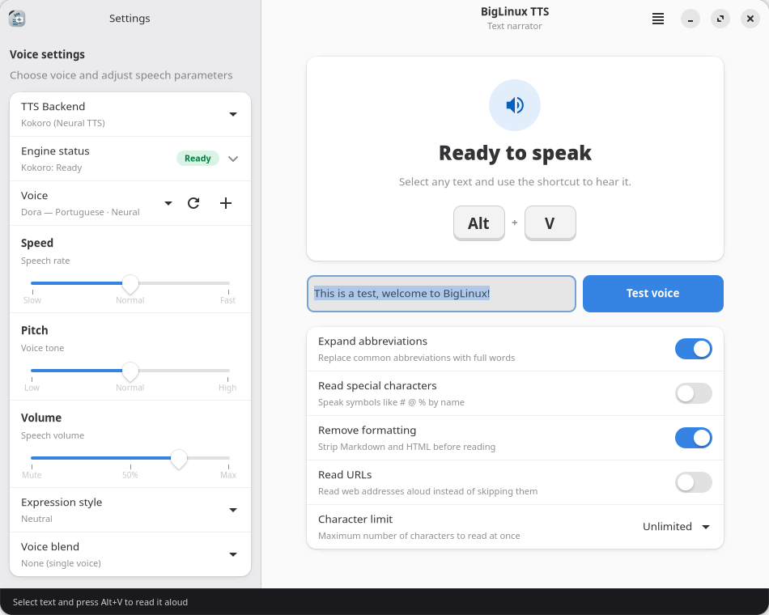
</picture>

</div>

---

**BigLinux TTS** is the text-to-speech tool of [BigLinux](https://www.biglinux.com.br/), a Brazilian distribution based on Manjaro and Arch Linux. Select text in any application, press the shortcut, and it is read aloud; press it again to stop. The package installs a Brazilian Portuguese voice that works without extra setup. All voices run on your computer.

The app uses Python, GTK4 and libadwaita for the interface and a native Rust engine (PyO3) for espeak-ng and Piper. You can choose between four speech engines: **RHVoice**, **espeak-ng**, **Piper** and **Kokoro**.

## Table of contents

- [Highlights](#highlights)
- [Screenshots](#screenshots)
- [Quick start](#quick-start)
- [Installation](#installation)
- [Usage](#usage)
- [Speech engines](#speech-engines)
- [Text processing](#text-processing)
- [Configuration and files](#configuration-and-files)
- [Troubleshooting](#troubleshooting)
- [Architecture](#architecture)
- [Technical details](#technical-details)
- [Internationalization](#internationalization)
- [Development and testing](#development-and-testing)
- [Packaging](#packaging)
- [Project structure](#project-structure)
- [Project history](#project-history)
- [Contributing](#contributing)
- [License](#license)
- [Authors](#authors)

---

## Highlights

| | |
| --- | --- |
| **One shortcut** | <kbd>Alt</kbd>+<kbd>V</kbd> by default, and you can change it. Press it to read the selected text and press it again to stop, also while the voice is still loading. |
| **Four engines** | RHVoice (the default, with the Brazilian Portuguese voice *Letícia*), espeak-ng (100+ languages), Piper (neural, native ONNX) and Kokoro (neural, voice blending). |
| **Clear status** | The *Ready to speak* card shows the real state: ready, loading the voice, speaking, stopped, or an error with its reason and a way to fix it, such as *Open Voice Manager*. Errors are never silent. |
| **Checked shortcut** | The shortcut is registered through the desktop's own API and the app reports it as active only after the desktop confirms it. On KDE, conflicts with other actions are shown by name. |
| **Playback controls** | Pause and resume where the audio stopped, a tray icon that pulses while reading, and an MPRIS mini-player for desktop media controls and media keys. |
| **History** | Every reading you heard is kept with its text and the exact audio that played, whatever the engine. You can search it, play it again or export it, and deleted entries go to the Trash. |
| **Text cleanup** | Abbreviations, numbers, dates and money are read as words, special characters are read by name, and HTML and Markdown are removed. The rules follow the language of the selected voice. |
| **Speech Dispatcher never started** | The app talks to every engine directly. It never starts or queries `speech-dispatcher`, because starting it can make other installed modules speak. |
| **Modern interface** | GTK4 + libadwaita (GNOME HIG): adaptive down to 360 px wide, light and dark styles, RTL support, reduced motion, accessible names. |
| **30 languages** | Every string is translated. Portuguese (Brazil) and Portuguese (Portugal) are separate catalogs. |
| **Official repositories only** | Every required dependency comes from the official Arch/Manjaro repositories. BigLinux extras are optional. |

---

## Screenshots

| Ready to speak (light) | Ready to speak (dark) |
| :---: | :---: |
|  | 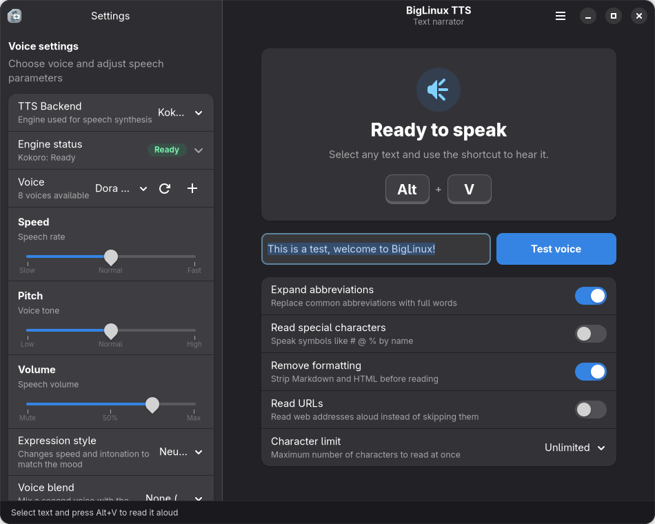 |
| **Speaking** | **Error with a way out** |
| 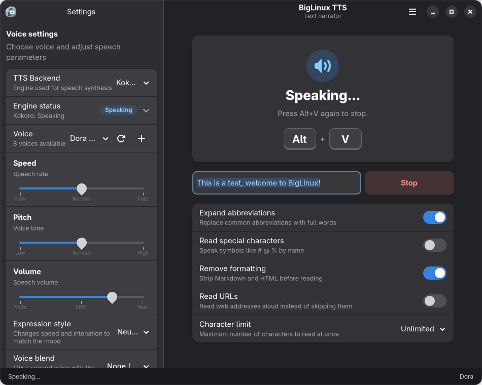 | 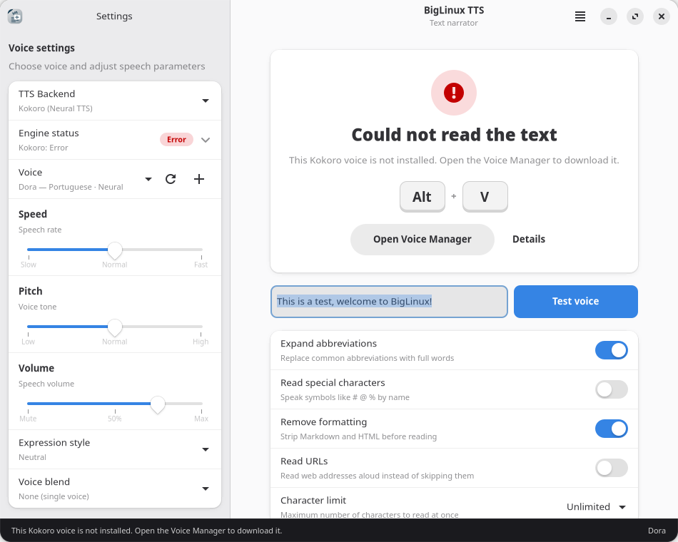 |
| **Engine status** | **Voice Manager** |
| 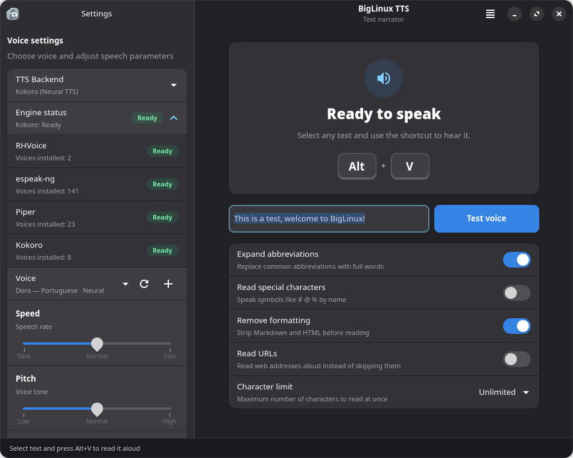 | 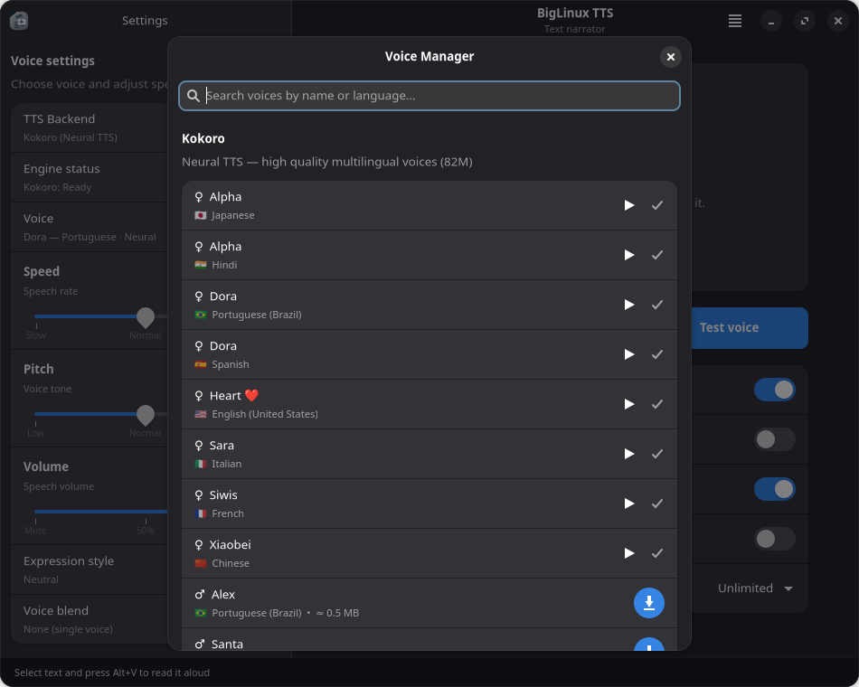 |
| **History** (main menu → History) | **Brazilian Portuguese interface** |
| 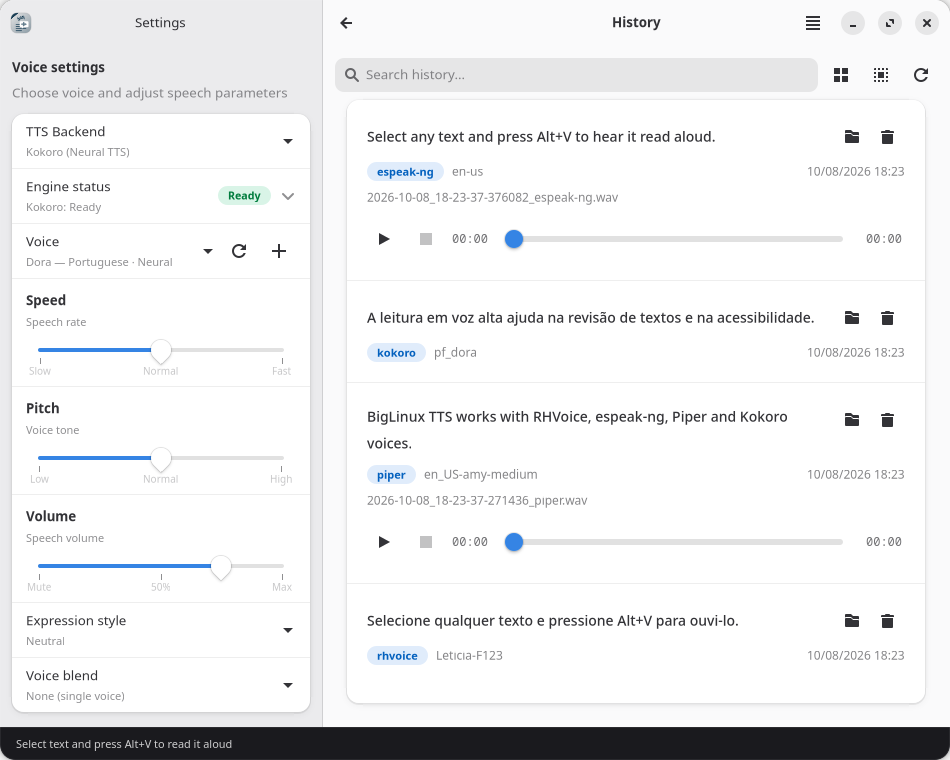 | 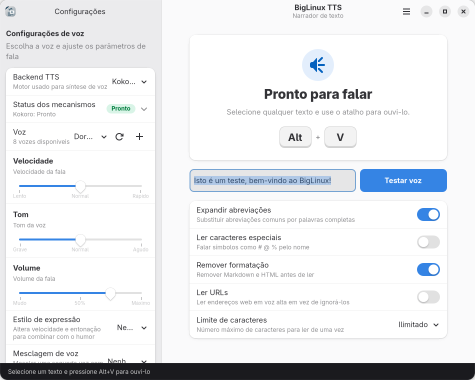 |
| **First run** | **Advanced options** |
| 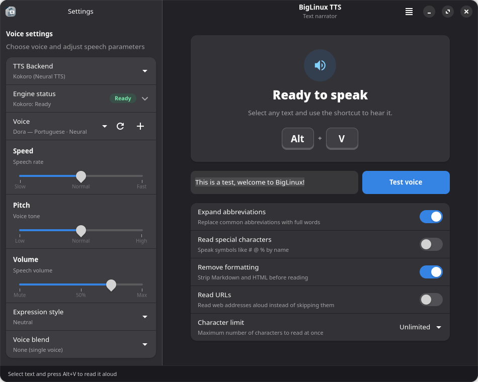 | 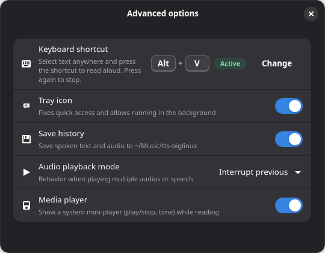 |

<table>
  <tr>
    <td align="center" width="40%">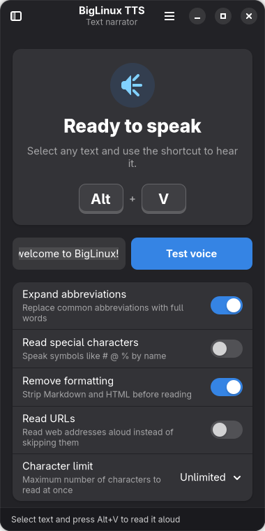<br><b>Narrow window</b> (360–600 px)</td>
    <td>
      <sub>Screenshots of version 4.1.0 with the BigLinux icon theme, rendered headless in a clean profile. The history entries are sample data.</sub>
    </td>
  </tr>
</table>

---

## Quick start

```bash
sudo pacman -S tts-biglinux     # BigLinux (other distributions: see Installation)
```

1. Open **BigLinux Text to Speech** from the application menu, or run `biglinux-tts`.
2. On the first run, a welcome dialog explains the basics. RHVoice with *Letícia* is already selected.
3. Select text in any application and press <kbd>Alt</kbd>+<kbd>V</kbd>. Press it again to stop.

The window is only for settings. The shortcut works with the window closed.

---

## Installation

### From the BigLinux repositories

```bash
sudo pacman -S tts-biglinux
```

### Manjaro and Arch Linux

The package builds from its PKGBUILD. All of its dependencies are in the official repositories (`core`, `extra`), so you do not need the BigLinux or Big Community repositories:

```bash
git clone https://github.com/biglinux/tts-biglinux.git
cd tts-biglinux/pkgbuild
makepkg -si
```

The package contains the application, the native engine, RHVoice with the Brazilian Portuguese voice *Letícia*, espeak-ng, the tray icon (PySide6), the History player (GStreamer) and the clipboard tools. That is everything you need to select text and press <kbd>Alt</kbd>+<kbd>V</kbd>.

> [!NOTE]
> The PKGBUILD's `source=` is the upstream Git repository, so `makepkg` builds `main` from GitHub and not your local files. To build another repository or branch, such as a checkout you have not published yet, set `TTS_BIGLINUX_SOURCE`:
>
> ```bash
> cd tts-biglinux/pkgbuild
> TTS_BIGLINUX_SOURCE="file://$PWD/..#branch=my-branch" makepkg -si
> ```
>
> A `file://` Git source only sees **committed** work on that branch.

### Optional voices and extras

```bash
# English RHVoice voice (official repositories)
sudo pacman -S rhvoice-voice-evgeniy-eng

# BigLinux repositories
sudo pacman -S biglinux-kokoro-tts     # Kokoro neural engine: koko, model, base voices
sudo pacman -S piper-voices-pt-br      # Brazilian Portuguese Piper voices (stable)
sudo pacman -S piper-voices-pt-BR      # the same voices, as spelled in biglinux-testing
```

You can also install voices from the **Voice Manager** in the app: RHVoice, Piper and espeak-ng voices as pacman packages, and Kokoro voices as downloads.

<details>
<summary><b>About the two Piper package spellings and the AUR</b></summary>

BigLinux stable spells the Piper voice package `piper-voices-pt-br` and testing spells it `piper-voices-pt-BR`. Both ship the same files, so you can install only one. When Piper is selected, the app looks for both spellings: first an installed one, then one in your repositories. It never offers the second spelling when one is already installed.

If neither spelling is in your repositories, the app falls back to the AUR and says so before installing. It builds the AUR package as you, never as root, using `pamac build` when pamac's AUR support is on, or else `paru` or `yay`. These helpers are optional dependencies.

</details>

### Running from a source checkout

```bash
git clone https://github.com/biglinux/tts-biglinux.git
cd tts-biglinux

# 1. Build the native engine against the SYSTEM ONNX Runtime
#    (linking a pip-provided onnxruntime breaks Piper at runtime)
cd tts-engine
ORT_LIB_LOCATION=/usr/lib ORT_PREFER_DYNAMIC_LINK=1 cargo build --release --locked
cd ..

# 2. Link it into the application directory (a checkout's own build wins
#    over an installed /usr/lib/tts-biglinux/tts_engine.so)
ln -sf ../../../../tts-engine/target/release/libtts_engine.so \
  usr/share/biglinux/tts-biglinux/tts_engine.so

# 3. Run. The launchers detect the checkout and use its code and catalogs.
./usr/bin/biglinux-tts --debug
```

Without the native engine, espeak-ng and Piper fall back to their command-line programs (`espeak-ng`, and `piper-tts` from `piper-tts-bin`).

While the checkout's own app is the one running, the global shortcut it registers runs the checkout's `usr/bin/biglinux-tts-speak`.

### Uninstalling

```bash
sudo pacman -R tts-biglinux
```

Removing the package leaves your personal data in your home folder: settings, history and downloaded Kokoro voices. To remove it as well, delete those folders (see [Configuration and files](#configuration-and-files)).

### Dependencies

Every required package comes from the official Arch/Manjaro repositories. This list matches `pkgbuild/PKGBUILD` (`epoch=1`, `pkgver=4.1.0`, `pkgrel=5`).

<details open>
<summary><b>Required (<code>depends</code>)</b></summary>

| Package | Why |
| --- | --- |
| `python`, `python-gobject` | Python 3 and PyGObject |
| `gtk4`, `libadwaita>=1:1.5` | Interface (`Adw.AlertDialog`, `Adw.OverlaySplitView`, `Adw.Breakpoint`) |
| `python-numpy` | Kokoro voice downloads (`.pt` → `.npy` conversion) |
| `polkit` | `pkexec` to install or remove voice packages |
| `onnxruntime` | Piper ONNX inference in the native engine (provided by `onnxruntime-cpu` and variants) |
| `espeak-ng` | espeak voices and the Piper phonemizer (linked by `tts_engine.so`) |
| `alsa-utils` | `aplay`: every engine plays through it |
| `alsa-lib` | Linked by `tts_engine.so` (rodio/cpal) |
| `sox` | Volume on the subprocess fallback paths |
| `gstreamer`, `gst-plugins-base`, `gst-plugins-good` | History player (`playbin`, `wavparse`, audio sinks) |
| `rhvoice`, `rhvoice-voice-leticia-f123` | Default engine and voice |
| `wl-clipboard` | Selected text on Wayland (`wl-paste`, also provided by `wl-clipboard-rs`) |
| `xsel` | Selected text on X11 |
| `xdg-utils` | `xdg-open`, the History *Open file location* fallback |
| `pyside6`, `qt6-svg` | System tray icon (the tray icons are SVG) |

</details>

<details>
<summary><b>Build and check (<code>makedepends</code>, <code>checkdepends</code>)</b></summary>

| Package | Why |
| --- | --- |
| `git` | Fetch the sources |
| `rust>=1.85`, `cargo` | Build `tts_engine.so` |
| `pkgconf` | `alsa-sys` finds `alsa-lib` through pkg-config |
| `python-pytest` | `check()` runs the Python test suite |

</details>

<details>
<summary><b>Optional (<code>optdepends</code>)</b></summary>

| Package | Repository | Why |
| --- | --- | --- |
| `rhvoice-voice-evgeniy-eng` | official | RHVoice English male voice |
| `xclip` | official | Selection capture on X11 when `xsel` is not available |
| `biglinux-kokoro-tts` | BigLinux | Kokoro neural voices (`koko`, model, base voices) |
| `piper-voices-pt-br` | BigLinux | Brazilian Portuguese Piper voices, preinstalled (`piper-voices-pt-BR` in testing) |
| `piper-tts-bin` | BigLinux | Piper command-line fallback (the native engine needs only the voices) |
| `rhvoice-brazilian-portuguese-complementary-dict-biglinux` | BigLinux | Extra pronunciation dictionary for RHVoice |
| `paru` (or `yay`, or `pamac` with AUR enabled) | AUR / BigLinux | Build Piper packages from the AUR when your repositories do not have them |

</details>

`speech-dispatcher` is not a dependency of this package. The `rhvoice` package may still pull it in, but this app never starts it.

---

## Usage

### The window

| Area | What it does |
| --- | --- |
| **Ready to speak** card | Current state (ready / loading voice / speaking / stopped / error with the fix) and the shortcut drawn as keys, plus whether the desktop confirmed it |
| **Voice settings** (sidebar) | Engine (*TTS Backend*), **Engine status** of all four engines, voice, speed, pitch, volume; for Kokoro also *Expression style* and *Voice blend* |
| **Test voice** | Type a short text and hear it with the current settings |
| Text options | Expand abbreviations, read special characters, remove formatting, read URLs, character limit |
| **Advanced options** | Keyboard shortcut, tray icon, history (save, keep audio, keep text, keep at most), audio playback mode, media player |
| Main menu (<kbd>F10</kbd>) | History, Show tray icon, Restore Defaults…, Welcome, About BigLinux TTS, Quit |

Engine status shows each engine as *Not installed*, *No voices* or *Ready*. For the selected engine it can also show *Loading*, *Speaking* or *Error*.

The slider ranges are speed −100…+100, pitch −100…+100 and volume 0…100. The defaults are −25, −25 and 75. Piper has no real pitch control, so the pitch row is relabeled *Expressiveness* for Piper. Kokoro does not follow pitch or volume levels; see [Speech engines](#speech-engines).

### Global shortcut

The default is <kbd>Alt</kbd>+<kbd>V</kbd>. You can change it in **Advanced options → Keyboard shortcut**. The shortcut must include <kbd>Ctrl</kbd>, <kbd>Alt</kbd> or <kbd>Super</kbd> (or be a function key), so that normal typing is never captured.

When pressed, it runs `biglinux-tts-speak`, which hands the request to the running app or starts one:

1. While a reading is loading or playing, it **stops** it (in the default *Interrupt previous* playback mode).
2. If text is selected, it **reads** it with the configured engine and voice.
3. If nothing is selected, a short notification says so.

| Desktop | How the shortcut is registered |
| --- | --- |
| KDE Plasma | KGlobalAccel over D-Bus (`doRegister`, `setForeignShortcut`), then read back with `allShortcutInfos`. Other actions using the key are found with `getGlobalShortcutsByKey`, reported by name, and the previous key is kept. If KGlobalAccel cannot be reached, the app writes `kglobalshortcutsrc` instead. |
| GNOME (and Unity) | `gsettings`: a custom keybinding in `org.gnome.settings-daemon.plugins.media-keys` |
| Cinnamon | `gsettings`: `org.cinnamon.desktop.keybindings` custom list |
| Xfce | `xfconf-query`, channel `xfce4-keyboard-shortcuts` |
| Any other desktop | The app does not claim a shortcut. Add one in your desktop's keyboard settings with the command **`biglinux-tts-speak`**. |

Registration runs in a background thread when the app starts. The card, Advanced options, the status bar and the tray tooltip update when the desktop answers.

### Tray icon and media controls

The tray icon is on by default. You can turn it off in Advanced options or with main menu → *Show tray icon*.

| Action | Idle | While reading |
| --- | --- | --- |
| Left click | Read the selected text | Stop |
| Right-click menu | Read text · Settings · Quit | Pause / Play · Stop · Settings · Quit |
| Icon | Static | Pulses (opacity only). Dims while paused. Stays steady when reduced motion is on |
| Tooltip | *Select text and press Alt+V to hear it* | *Playing…* / *Paused* |

With the tray icon on, closing the window hides it to the tray. **Pause** freezes the player in place and **Play** continues from the same point.

The **MPRIS** player (`org.mpris.MediaPlayer2.biglinux-tts`) shows a system mini-player with Play/Pause, Stop and progress while a reading plays. It responds to media keys, and Play when idle reads the last text again. You can turn it off in Advanced options → *Media player*.

Notifications show what is being read, and give a clear message when something fails or nothing is selected.

### Command line

| Command | What it does |
| --- | --- |
| `biglinux-tts` | Open the window, or bring the running one forward |
| `biglinux-tts --speak` | Read or stop the selected text (the shortcut action) |
| `biglinux-tts-speak` | Same as `biglinux-tts --speak`; this is the command bound to the shortcut |
| `biglinux-tts --debug` | Detailed logging on the terminal |
| `biglinux-tts --version` | Print the version |

The app runs as a single instance (GApplication `br.com.biglinux.tts`). A second command is passed to the instance that is already running. After the last reading, the app stays alive for a few seconds, so a quick second <kbd>Alt</kbd>+<kbd>V</kbd> reuses it.

### Playback modes

You set this in **Advanced options → Audio playback mode**:

| Mode | A new reading while one is playing… |
| --- | --- |
| **Interrupt previous** (default) | replaces it. The shortcut works as a toggle and stops a reading in progress |
| **Queue** | waits and plays when the current one ends. Stop also clears the queue |
| **Simultaneous** | plays alongside it. Stop and Pause apply to every reading |

### History

Open it from the main menu → **History** (<kbd>Ctrl</kbd>+<kbd>H</kbd>). Saving is on for new installations. Settings from earlier versions keep their own choice, and History is never switched on silently for an existing user.

- **What is kept** for each reading that was actually heard: the original text, the processed text, engine, voice, date and time, duration, outcome (*completed*, *stopped* by you, or *error* after sound started), and the audio.
- **The audio is what was played**, not a second synthesis. A stopped reading keeps the audio up to the point where you stopped it.

  | Engine | How the audio is captured |
  |---|---|
  | RHVoice | `RHVoice-test` writes WAV to stdout. The app sends it to `aplay` and writes the same bytes to the history file |
  | espeak-ng, Piper | Each WAV chunk is appended to the history file when it starts playing. A long text gives one file for the whole reading |
  | Kokoro | `koko pipe -o <file>` writes everything it plays straight into the history file |

- **The page** shows cards with the text (expandable), engine, voice, date, duration and outcome, a player, and actions: copy, *Read again with the current voice*, *Save audio as…*, open the folder, delete. You can search (text, voice, engine, date), filter (all dates, today, yesterday, last 7 days, engine), sort newest or oldest first, switch between list and grid, and select several entries to save them to a folder or delete them. New readings appear on their own, and entries load in pages as you scroll.
- **Deleting is safe.** A single entry can be undone with *Undo*, a selection asks for confirmation first, and the files go to the **Trash**. Files you restore from the Trash come back as entries on the next start.
- **Recovery runs at every start**, outside the main thread. A damaged index is set aside as `history.db.damaged-…` and rebuilt from the files. Files without an entry come back, a recording interrupted by a crash is finished and kept, and a legacy `history.json` is migrated once. Recovery never deletes anything that was saved.
- **Limits** are set in *Keep at most* (100, 500, 1000, 5000 or unlimited). Saving runs in a background thread: it never delays the start of speech, and a failure such as a full disk or a missing permission never stops a reading.

### Voice Manager

- Install and remove voices for RHVoice, Piper and espeak-ng (pacman packages through `pkexec`) and Kokoro (downloaded voice files).
- Before installing, the app checks the package with `pacman -Si`. It only ever runs `pkexec pacman -S --needed`, never `-Sy`, because refreshing the databases without upgrading would be a partial upgrade.
- Each voice has one button to play and stop a sample. You can search by name or language, and the size is shown before you install.
- Kokoro downloads show real progress and have a **Cancel** button. Downloads are verified (incomplete or damaged files are rejected) and free space is checked first. `voices.bin` is updated atomically.
- Removing a voice asks for confirmation.

### Keyboard shortcuts in the window

| Shortcut | Action |
| --- | --- |
| <kbd>Alt</kbd>+<kbd>V</kbd> (global, configurable) | Read / stop the selected text |
| <kbd>Ctrl</kbd>+<kbd>H</kbd> | Open History |
| <kbd>Esc</kbd> / <kbd>Alt</kbd>+<kbd>←</kbd> | Back from History |
| <kbd>F10</kbd> | Open the main menu |
| <kbd>Ctrl</kbd>+<kbd>Q</kbd> | Quit |

---

## Speech engines

| | RHVoice | espeak-ng | Piper | Kokoro |
| --- | --- | --- | --- | --- |
| **Kind** | Parametric, multilingual | Formant, very light | Neural (ONNX) | Neural (ONNX) |
| **Default** | **Yes**, voice *Letícia F123* (pt-BR) | | | |
| **Comes with the package** | Yes (`rhvoice`, `rhvoice-voice-leticia-f123`) | Yes (`espeak-ng`) | Engine yes, voices optional | No (`biglinux-kokoro-tts`) |
| **How it runs** | `RHVoice-test` → WAV on stdout → `aplay` | Native FFI to `libespeak-ng`. Fallback: `espeak-ng` command | Native ONNX via the Rust engine. Fallback: `piper-tts` command | `koko pipe` (sentence by sentence) |
| **Languages** | Voices installed (pt-BR, English, others) | 100+ | Voices installed | pt-BR, en-US, en-GB, es, fr, it, hi, ja, zh |
| **Speed** | Yes | Yes | Yes | Yes (speed × expression preset) |
| **Pitch** | Yes | Yes | Shown as *Expressiveness* (noise scale) | No (slider disabled) |
| **Volume** | Yes | Yes | Yes | Only mute (0) |
| **Long texts** | One stream, text through stdin | 600-character chunks, streamed | 600-character chunks, streamed | One sentence per line, long sentences split |

<details>
<summary><b>RHVoice</b> (default)</summary>

- Installed with the package together with the Brazilian Portuguese voice *Letícia*. It plays as `RHVoice-test | aplay` for reading and for the Voice Manager preview.
- The text goes through stdin, so there is no size limit.
- Voices are found by scanning `/usr/share/RHVoice/voices/` and `/usr/local/share/RHVoice/voices/`. Speech Dispatcher is not queried.
- Settings that still name the removed `speech-dispatcher` engine (dropped in 4.0) are switched to RHVoice.

</details>

<details>
<summary><b>espeak-ng</b></summary>

- Calls `libespeak-ng.so` directly from the Rust engine, with no synthesis subprocess. It runs in `AUDIO_OUTPUT_SYNCHRONOUS` mode, so espeak-ng renders PCM and never opens the audio device itself. espeak-ng is also Piper's phonemizer.
- It is initialized once (`OnceLock`) and all calls are serialized.
- Texts longer than 600 characters are streamed in sentence chunks. Sound starts right away, memory stays bounded, and Stop takes effect between chunks.
- Without the native engine, the `espeak-ng` command is used. A hung process is stopped after 120 s of work (time spent paused does not count).
- Voices come from `espeak-ng --voices`.

</details>

<details>
<summary><b>Piper</b></summary>

- **Pipeline:** text → espeak-ng IPA phonemes (FFI) → phoneme IDs → ONNX model (`ort` crate, system ONNX Runtime, dynamic link) → WAV → `aplay`.
- The model is loaded once and cached. The selected voice is prewarmed in the background after startup, with no audio, so the first <kbd>Alt</kbd>+<kbd>V</kbd> starts faster.
- On long texts, the next chunk is synthesized while the current one plays.
- If the native engine is missing or fails, the `piper-tts` command (`piper-tts-bin`) is used, and its output is played through sox `play` so the volume still applies.
- Voices (`.onnx` + `.onnx.json`) are found in `/usr/share/piper-voices/`, `/usr/local/share/piper-voices/` and `~/.local/share/piper-voices/`.

</details>

<details>
<summary><b>Kokoro</b></summary>

- Runs the `koko` binary from `biglinux-kokoro-tts` (model in `/usr/share/biglinux-kokoro-tts/model/`, base voices in `/usr/share/biglinux-kokoro-tts/voices/voices.bin`).
- One builder (`kokoro_voice_service.build_koko_command`) creates the command for both reading and the Voice Manager preview. It passes an explicit model, the voices file, the language from the voice prefix (`pf_`/`pm_` → pt-br, `af_` → en-us, …), and a private writable work directory (`$XDG_RUNTIME_DIR/biglinux-tts/koko`). koko fails with *Permission denied* when it runs in the read-only install folder.
- It uses `koko pipe -o <file>`: one sentence per line, played as soon as it is synthesized, with everything written to a WAV file (the history recording). `koko stream` is not used because it mixes log lines into the audio.
- The card shows *Loading voice* until koko reports *Streaming audio*. A crash of koko is reported as an error.
- The selected voice is checked against `voices.bin` before speaking, because koko would otherwise use another voice without saying so.
- **Voice blending** mixes a second voice (`voice.W+voice.W`). **Expression presets** (neutral, happy, calm, urgent, narrative) adjust the speed.
- **Pitch** is disabled, because koko has no such option. **Volume** only honors mute (0); use the system volume for the level.
- You can download more voices in the Voice Manager. They are stored in `~/.local/share/biglinux-tts/kokoro-voices/voices.bin`, together with the base voices.

</details>

All engines are scanned in parallel in a background thread. The result is a voice catalog, plus each engine's status (installed, has voices) as shown under *Engine status*.

---

## Text processing

`services/text_processor.py` prepares the text before synthesis. The rules follow the **language of the selected voice**, so an English voice on a Portuguese desktop gets English rules. The options apply to every engine.

| Option | What it does | Example |
| --- | --- | --- |
| Expand abbreviations | Expands slang and titles (pt, en, es). Never applied inside e-mail addresses, URLs or hyphenated words | `vc` → "você", `Dr. Silva` → "doutor Silva", `w/o` → "without" |
| Read special characters | Reads symbols by name (pt, en, es). When off, the symbols that engines would read aloud are removed | `#` → "cerquilha" / "hash" |
| Remove formatting | Removes HTML tags and Markdown markers. Headings keep a pause and numbered lists keep their numbers | `**bold**` → "bold" |
| Read URLs | On: reads only the domain. Off: removes the URL | `https://www.example.com/a?b=1` → "example.com" |
| Character limit | Unlimited, 1K, 5K, 10K, 50K or 100K, cut at a sentence or word boundary | |
| Number normalization | Portuguese voices: numbers, money, percentages, dates and times as words. On by default, with no switch in the window (settings key `text.normalize_numbers`) | `R$ 1.234,56`, `08/10/2026`, `21:00` → "vinte e uma horas" |

<details>
<summary><b>Pipeline order</b></summary>

1. **Character limit:** cut at a sentence or word boundary.
2. **Strip formatting:** only real HTML tags are removed (`x < 5 e y > 3` stays), plus Markdown bold, italic, code, links, headings and bullets. HTML entities are always decoded.
3. **URLs:** replaced by the domain, or removed together with the space before them.
4. **Numbers** (pt): numbers, money, percentages, dates and times (feminine hours, seconds). This step runs before special characters, so `%` and `R$` become words.
5. **Abbreviations:** one precompiled pattern per language, and titles drop their period. With the option off, slang is spelled out so RHVoice does not expand it on its own (real words are left alone).
6. **Special characters:** read by name, or the symbols espeak-ng-based engines would read are removed.
7. **Cleanup:** spaces are collapsed and paragraph breaks are kept as pauses.

</details>

---

## Configuration and files

| Path | Content |
| --- | --- |
| `~/.config/biglinux-tts/settings.json` | All settings (JSON, written atomically) |
| `~/.config/biglinux-tts/settings.json.corrupt` (`.corrupt.N`) | A settings file that could not be parsed, kept for you. Earlier copies are never overwritten |
| `~/.config/tts-biglinux/` | Legacy settings (`rate`, `pitch`, `volume`, `voice`), migrated once to `settings.json` |
| XDG Music folder + `tts-biglinux/`, e.g. `~/Music/tts-biglinux/` or `~/Músicas/tts-biglinux/` | History: one `<timestamp>_<engine>.wav` / `.txt` pair per reading and the SQLite index `history.db`. The folder is private (mode 0700) |
| `~/.local/share/biglinux-tts/kokoro-voices/voices.bin` | Kokoro voices you downloaded (base voices + downloads) |
| `~/.local/share/piper-voices/` | Per-user Piper voices (also scanned) |
| `$XDG_RUNTIME_DIR/biglinux-tts/koko/` | Kokoro scratch audio (private, temporary) |
| `~/.local/share/applications/biglinux-tts-speak.desktop` | Launcher bound to the global shortcut (KDE also mirrors it into `~/.local/share/kglobalaccel/` when a copy exists there) |
| `/usr/lib/tts-biglinux/tts_engine.so` | Native Rust engine (installed) |
| `/usr/share/tts-biglinux/locale/*.po` | Installed translations |

The History folder comes from GLib's XDG user directories, so it follows a localized name such as *Músicas* or *Musik*.

<details>
<summary><b>Settings schema (defaults)</b></summary>

```json
{
  "speech": {
    "rate": -25,
    "pitch": -25,
    "volume": 75,
    "voice_id": "",
    "backend": "rhvoice",
    "kokoro": {
      "voice_blend": "",
      "blend_ratio": 0.5,
      "emotion_preset": "neutral"
    }
  },
  "text": {
    "expand_abbreviations": true,
    "process_urls": false,
    "process_special_chars": true,
    "strip_formatting": true,
    "normalize_numbers": true,
    "max_chars": 0
  },
  "shortcut": {
    "keybinding": "<Alt>v",
    "show_in_launcher": true
  },
  "window": {
    "width": 900,
    "height": 740,
    "maximized": false
  },
  "history": {
    "enabled": true,
    "save_audio": true,
    "save_text": true,
    "playback_mode": "interrupt",
    "max_entries": 1000,
    "max_age_days": 0
  },
  "show_welcome": true,
  "show_media_player": true,
  "config_version": 1
}
```

- `backend` can be `rhvoice`, `espeak-ng`, `piper` or `kokoro`. Any other value, such as the removed `speech-dispatcher`, becomes `rhvoice`.
- `playback_mode` can be `interrupt`, `queue` or `simultaneous`. `show_in_launcher` turns the tray icon on. `max_chars: 0` means unlimited.

</details>

**How damaged settings are handled:**

- **Wrong value:** a single bad value falls back to its default, and the other settings are kept.
- **Unparsable file:** it is moved to `settings.json.corrupt` and the defaults are used. History stays off.
- **Unreadable file** (permissions, a folder in its place): the app uses the defaults for that run and never saves over the file.
- **Missing `history` section:** a settings file without it comes from a version where History was off by default, so History stays off.

---

## Troubleshooting

> [!TIP]
> To collect diagnostics for a bug report, open the main menu → **About BigLinux TTS** → **Troubleshooting**. From there you can copy or save `biglinux-tts-diagnostic.txt`.

### The global shortcut does nothing

1. Open **Advanced options**. The shortcut row says whether the desktop confirmed it (*Active*) or names the action that already uses the key.
2. Test the command itself: select some text and run `biglinux-tts-speak` in a terminal. If it reads, the problem is the key binding and not the app.
3. **KDE Plasma:** older versions registered the shortcut under other component names. Those can still claim <kbd>Alt</kbd>+<kbd>V</kbd>, so the key fails, typically right after login while the app is closed. List the components:

   ```bash
   qdbus6 org.kde.kglobalaccel /kglobalaccel org.kde.KGlobalAccel.allComponents
   # without qt6-tools:
   dbus-send --session --print-reply --dest=org.kde.kglobalaccel \
     /kglobalaccel org.kde.KGlobalAccel.allComponents
   ```

   Only `/component/biglinux_tts_speak_desktop` should belong to this app. Leftovers such as `bigtts_desktop`, `tts_speak_desktop` or `br_com_biglinux_tts_desktop` come from old versions. To see the key that is really active:

   ```bash
   qdbus6 org.kde.kglobalaccel /component/biglinux_tts_speak_desktop \
     org.kde.kglobalaccel.Component.allShortcutInfos
   ```

   kglobalaccel loads every launcher in `~/.local/share/kglobalaccel/` at each login. Old copies there (`bigtts.desktop`, `tts-speak.desktop`, `br.com.biglinux.tts.desktop`) bring the stale components back. The app deletes them when it starts (only files whose `Exec` runs `biglinux-tts`) and drops the stale components from memory. Open the app once, or log out and back in.

4. **GNOME, Cinnamon, Xfce:** look for the *BigLinux TTS* entry in the desktop's custom keyboard shortcuts.
5. **Other desktops:** the app cannot register a shortcut there. Add one by hand in the keyboard settings with the command `biglinux-tts-speak`.

### "No text selected" or nothing is read

- The app reads the **primary selection** (the highlighted text). If that is empty, it falls back to the clipboard.
- On Wayland it uses `wl-paste` (package `wl-clipboard`). On X11 it uses `xsel`, or `xclip` when `xsel` is missing. If the tool is missing, a notification says what to install.
- Only text is requested, so an image on the clipboard is skipped.

### The app does not start: `'utils' is not a package`

```text
ModuleNotFoundError: No module named 'utils.i18n'; 'utils' is not a package
```

A `pip install --user` package that puts a top-level `utils.py` (or `services`, `ui`) in `~/.local/lib/python3.*/site-packages/` used to shadow the app's own modules. Since `1:4.1.0-4`, the app's folders are regular packages and the launchers and the tray helper run **`python3 -s`**, which ignores user site-packages. If you start `main.py` yourself, use `python3 -s main.py`.

### A fix disappeared after an update

A repository with an older build can **downgrade** the package, for example a pamac update with downgrades allowed, or a `pacman -S` reinstall from a repository that still has an older `pkgrel`. Check the installed version and the log:

```bash
pacman -Q tts-biglinux                 # 1:4.1.0-5 or newer expected
grep downgraded /var/log/pacman.log | grep tts-biglinux
```

If it was downgraded, reinstall a current build, for example from the PKGBUILD (see [Installation](#manjaro-and-arch-linux)).

### No tray icon (GNOME)

The tray icon uses `QSystemTrayIcon` (StatusNotifierItem). Plain GNOME has no tray host, so you need an extension such as *AppIndicator and KStatusNotifierItem Support*. Without a tray host, the app drops the tray: closing the window then quits the app as usual, and the global shortcut still works because it starts the app on demand.

### Kokoro is silent or reports an error

- Install `biglinux-kokoro-tts`. The card offers *Open Voice Manager* when a voice or the model is missing.
- The volume slider only honors 0 (mute) and the pitch slider is disabled. These are koko limits, not faults.

### Reading the debug log

```bash
biglinux-tts --debug
```

The app is a single instance, so the log appears in the terminal of the process that started first. Quit the running instance first (<kbd>Ctrl</kbd>+<kbd>Q</kbd> or tray → Quit), then start it with `--debug`, and use the shortcut or `biglinux-tts --speak` from another terminal.

---

## Architecture

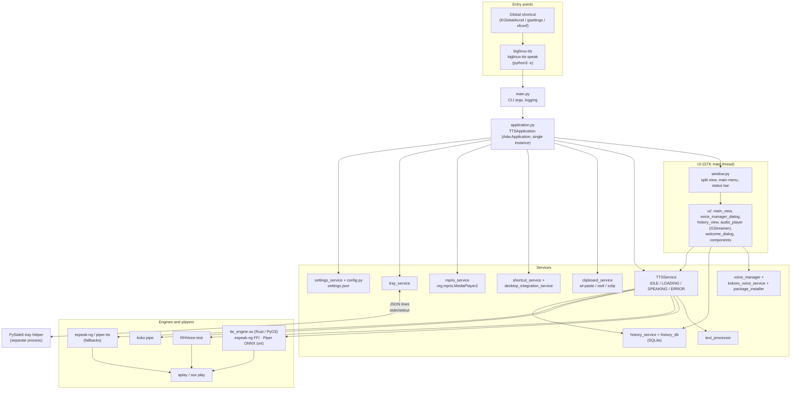

### Request lifecycle

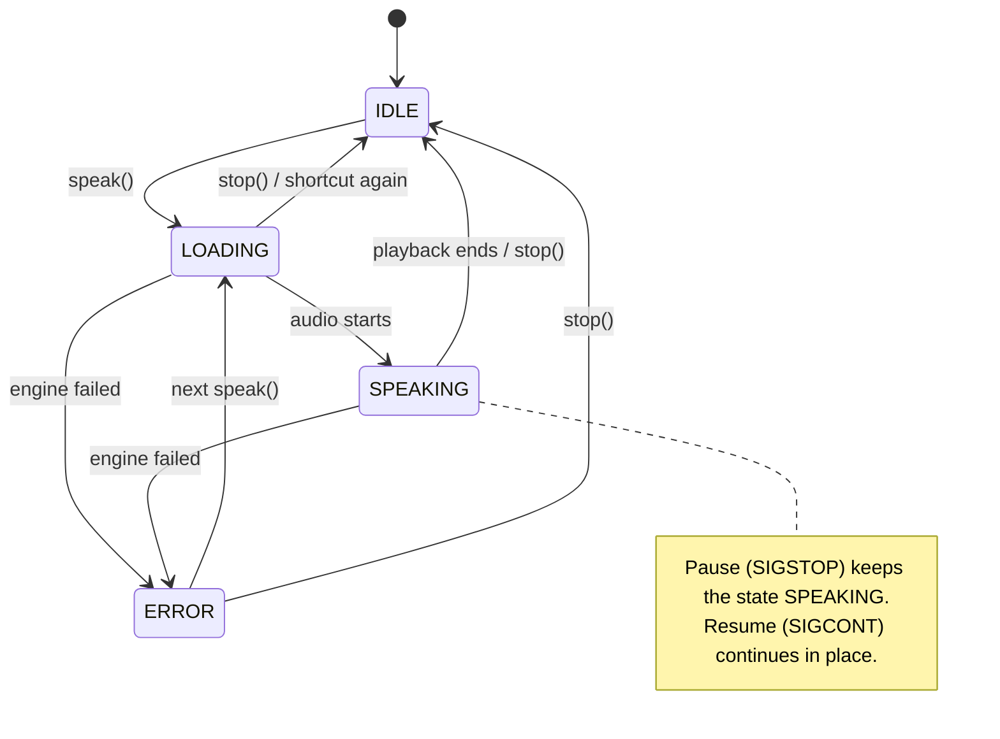

- `LOADING` reflects real work. Every engine synthesizes before any sound, and the state switches to `SPEAKING` when the player starts, or when `koko` reports *Streaming audio*.
- `ERROR` carries a translated message and an action (`voice-manager` or `retry`). It is never reset to idle behind your back, only by the next speak or stop.
- A monotonic **request generation** is bumped by `stop()` only, never by `speak()`. A worker never starts audio for a generation that is gone, so audio from an interrupted request cannot start late. Simultaneous readings share one generation.
- State listeners always run on the GTK main thread.

---

## Technical details

<details>
<summary><b>Rust native engine</b> (<code>tts-engine/</code>)</summary>

```text
tts-engine/
├── Cargo.toml          # PyO3 0.25, ort =2.0.0-rc.10, rodio 0.20, hound, serde, thiserror
├── build.rs            # PyO3 extension link args + libespeak-ng
└── src/
    ├── lib.rs          # PyO3 module: version, speak_espeak, synthesize_espeak,
    │                   #   speak_piper, synthesize_piper, load_piper, stop
    ├── audio.rs        # rodio playback with an AtomicBool stop flag
    ├── error.rs        # TtsError (thiserror)
    └── backends/
        ├── espeak.rs   # FFI to libespeak-ng (synchronous mode, serialized)
        └── piper.rs    # phonemize → IDs → ONNX inference → WAV; model cache
```

- Every synthesis and model load runs inside `py.allow_threads`, so the GIL is released and the GTK main loop keeps running.
- The app uses the `synthesize_*` functions and plays the returned WAV with `aplay`, so playback can be paused (SIGSTOP/SIGCONT) and stopped like every other engine.
- `ort` is pinned exactly and built with `--locked` against the system ONNX Runtime (`ORT_LIB_LOCATION=/usr/lib ORT_PREFER_DYNAMIC_LINK=1`). An unpinned or pip-provided onnxruntime once broke the module at runtime.
- espeak-ng must stay in `AUDIO_OUTPUT_SYNCHRONOUS` mode. In any other mode it opens the audio device itself.

</details>

<details>
<summary><b>Kokoro text preparation</b></summary>

The Kokoro model accepts at most 510 phoneme tokens per segment. `koko pipe` splits input into sentences but does not limit their length, and a long sentence makes it panic. `prepare_koko_text()` therefore:

- turns ASCII ellipses into `…` and collapses runs of sentence signs (`?!`, `!!!`, `Fim.!`, `etc….`, also across closing quotes or brackets) into one sign. koko exits with `SendError` on the punctuation-only piece such runs leave behind;
- writes one sentence per line and splits sentences longer than **220 characters** at commas, then at word boundaries;
- drops segments that contain no letter or digit, and ends each piece with punctuation so koko treats it as its own segment.

</details>

<details>
<summary><b>Selected text capture</b></summary>

`services/clipboard_service.py` detects the display server:

- **Wayland:** `wl-paste --primary --no-newline --type text`, falling back to the regular clipboard.
- **X11:** `xsel --primary -o`, then `xsel --clipboard -o`, then `xclip`.
- Only text is requested, and the output is decoded leniently. Capture runs in a background thread.

</details>

<details>
<summary><b>System tray IPC protocol</b></summary>

The tray runs as a separate PySide6 process (`/usr/bin/python3 -s`), which avoids mixing GTK4 and Qt in one process. The two processes exchange JSON lines over stdin/stdout:

```text
GTK app (parent)                          PySide6 helper (child)
    │── {"cmd":"set_menu","items":[…]} ──────▶│  fixed rows; only label/visible/enabled change
    │── {"cmd":"set_tooltip","text":…} ──────▶│  idle tooltip shows the shortcut
    │── {"cmd":"set_speaking",…} ────────────▶│  pulse / dim (paused) / steady (reduced motion)
    │── {"cmd":"update_icon"} ───────────────▶│
    │◀── {"event":"ready"} ───────────────────│  icon visible
    │◀── {"event":"activate"} ────────────────│  left click while idle → read
    │◀── {"event":"player","action":"stop"} ──│  left click while reading
    │◀── {"event":"menu","id":N} ─────────────│  menu row clicked
    │◀── {"event":"error","message":…} ───────│  no PySide6 / no tray host / crash
    │── {"cmd":"quit"} ──────────────────────▶│
```

- The menu is **static**. The full row set is sent in a fixed order and only properties change, because structural rebuilds do not propagate reliably through Plasma's DBusMenu. Rows are flat, since nested tray submenus are unreliable on Plasma Wayland.
- The pulsing icon (`tray_icon_frames.py`) changes opacity only. Every frame keeps the original pixel size **and** device-pixel ratio, so the icon never shrinks on scaled screens. Frames are cached per opacity level, sizes are limited to 16–48 px per screen scale, and the timer stops when the reading ends or pauses.

</details>

<details>
<summary><b>Threading and lifecycle</b></summary>

- **Workers:** clipboard capture, voice discovery, shortcut registration, synthesis, history saving, history recovery and downloads all run in daemon threads, and results return through `GLib.idle_add()`. No blocking work runs on the GTK main thread.
- **Requests:** a generation counter discards stale audio, and a per-reading id keeps simultaneous readings apart. A player started after Stop is terminated at once.
- **Pause:** SIGSTOP/SIGCONT on the reading's processes, under a lock shared with workers that start a new player, so the next chunk's player is also frozen while paused.
- **Watch:** a 300 ms `GLib.timeout_add()` follows the player process and its exit status. Exit by a crash signal (SIGABRT, SIGSEGV, …) is reported as an engine error.
- **Settings:** saved 500 ms after the last change.
- **Shutdown:** SIGTERM, SIGINT and SIGHUP quit cleanly, so no player keeps speaking after logout.
- **Startup:** the tray, shortcut registration and MPRIS come first. After 1 s the Piper model is prewarmed (no audio), and after 2 s History recovery runs. Opening the app never speaks.

</details>

---

## Internationalization

Translations are gettext `.po` catalogs, read directly by a small parser (`utils/i18n.py`) with no `.mo` compilation. This is the format BigLinux's translation pipeline produces.

- **Language selection** follows GNU gettext. `LC_ALL` > `LC_MESSAGES` > `LANG` decide the locale. A `C`/`POSIX` locale means English. Otherwise `LANGUAGE` (a colon-separated list) takes precedence.
- **Fallback per message:** through the `LANGUAGE` list and from region to language (`pt_BR` → `pt-BR.po` → `pt.po`), then English. Catalog names match case-insensitively, and `nb`/`nn` use `no.po`.
- **Search paths:** `<checkout>/locale/` in a source checkout, then `/usr/share/tts-biglinux/locale/` when installed.
- **Language and country names** in voice lists come already translated from the system's `iso-codes`.

```python
from utils.i18n import _
label.set_text(_("Ready to speak"))  # → "Pronto para falar" in pt-BR
```

> [!IMPORTANT]
> Every user-visible string must be a **literal inside `_()`**. The pipeline extracts strings with plain `xgettext`, which does not see `N_()` or strings inside f-strings, so such a string would be dropped from every catalog on the next run. A test enforces this.

**Available languages (30):**

| Code | Language | Code | Language | Code | Language |
| --- | --- | --- | --- | --- | --- |
| bg | Bulgarian | fi | Finnish | no | Norwegian |
| ca | Catalan | fr | French | pl | Polish |
| cs | Czech | he | Hebrew | pt | Portuguese (Portugal) |
| da | Danish | hr | Croatian | pt-BR | Portuguese (Brazil) |
| de | German | hu | Hungarian | ro | Romanian |
| el | Greek | is | Icelandic | ru | Russian |
| en | English | it | Italian | sk | Slovak |
| es | Spanish | ja | Japanese | sv | Swedish |
| et | Estonian | ko | Korean | tr | Turkish |
| zh | Chinese | nl | Dutch | uk | Ukrainian |

**Workflow:**

- `locale/tts-biglinux.pot` is the template. The *Translate and Build Package* workflow translates new strings for the catalogs. Brazilian Portuguese is not translated by the pipeline and is maintained by hand.
- `python3 scripts/sync_translations.py` regenerates the template exactly as the pipeline does and brings every catalog in line, keeping existing translations. `--merge pt-BR=file.json` adds new translations from a `{"English": "translation"}` file.
- `python3 scripts/sync_translations.py --check` changes nothing. It fails if a catalog cannot be read or a translation uses a `{placeholder}` its source does not have.

**Adding a language:** copy `locale/tts-biglinux.pot` to `locale/<code>.po` and set `Language:` in the header. Translate the `msgstr` entries, keeping `{placeholders}`, line breaks and markup unchanged. Then run `--check`. No compilation step is needed.

---

## Development and testing

You need the runtime dependencies plus `rust`, `cargo`, `pkgconf`, `python-pytest`, `ruff` and `gettext` (for `xgettext`).

```bash
# Lint and byte-compile
ruff check usr/share/biglinux/tts-biglinux tests scripts
python -m compileall -q usr/share/biglinux/tts-biglinux

# Translations
python3 scripts/sync_translations.py --check

# Python tests (GTK widget tests skip themselves without a display)
PYTHONDONTWRITEBYTECODE=1 python -m pytest -q -p no:cacheprovider tests

# Python tests including the GTK widget tests, headless (Broadway backend)
gtk4-broadwayd :5 &
GDK_BACKEND=broadway BROADWAY_DISPLAY=:5 python -m pytest -q -p no:cacheprovider tests

# Rust engine
cd tts-engine
cargo fmt --all -- --check
ORT_LIB_LOCATION=/usr/lib ORT_PREFER_DYNAMIC_LINK=1 cargo clippy --all-targets --all-features --locked -- -D warnings
ORT_LIB_LOCATION=/usr/lib ORT_PREFER_DYNAMIC_LINK=1 cargo test --release --locked
cd ..

# Native engine benchmark (time to first audio, real-time factor; JSON output)
python3 scripts/benchmark_tts.py
```

The suite has 355 Python tests and 4 Rust tests at 4.1.0-5. `tests/conftest.py` redirects the History folder, the Trash and `settings.json` into temporary folders for every test, so the suite **never touches your real history or settings**.

<details>
<summary><b>What the tests cover</b></summary>

| Area | Files |
| --- | --- |
| Request lifecycle and race guards | `test_tts_lifecycle.py`, `test_race_guard.py`, `test_speech_fixes.py` (fake `koko` process: LOADING → SPEAKING → IDLE, sticky errors, crashes, stop while loading, huge texts never block) |
| Streaming and history recording | `test_tts_streaming.py`, `test_history.py`, `test_history_db.py`, `test_history_fixes.py`, `test_history_recovery.py` |
| History page and entry points | `test_history_view.py`, `test_history_view_lazy.py`, `test_entry_points_history.py` |
| Text | `test_text_rules.py`, `test_text_numbers.py`, `test_special_chars.py`, `test_chunking.py`, `test_koko_text.py` |
| Kokoro | `test_koko_workdir.py`, `test_kokoro_download.py` |
| Voices and packages | `test_voice_manager_rows.py`, `test_voice_sizes.py`, `test_package_installer.py`, `test_preview_lang.py`, `test_param_mappings.py` |
| Interface | `test_ui_states.py`, `test_tray_breathing.py`, `test_download_progress.py` |
| Desktop and startup | `test_kde_launchers.py`, `test_startup_fixes.py`, `test_module_shadowing.py`, `test_clipboard.py`, `test_diagnostics.py` |
| Settings, data and release | `test_config.py`, `test_user_data_isolation.py`, `test_release.py` (one version and one author list in config, Cargo, PKGBUILD and this README) |
| Translations | `test_i18n.py` (parser, GNU language precedence, every string extractable by `xgettext`, complete Portuguese catalogs) |
| Native engine | `test_engine_native.py` (skipped without the built engine) |

</details>

### Continuous integration

- **`.github/workflows/ci.yml`** runs on pull requests and on pushes to `main`, in an Arch Linux container with the official repositories. It has three jobs:
  - **python:** ruff, compileall, translation check, pytest.
  - **rust:** `cargo fmt`, clippy with `-D warnings`, `cargo test`.
  - **pkgbuild:** `namcap` and `makepkg --printsrcinfo`.
- **`.github/workflows/translate-and-build-package.yml`** runs only in the `biglinux` organization. It updates the translations, discards them if they fail `--check`, commits them, and asks the BigLinux build service for a package.

---

## Packaging

```bash
cd pkgbuild && makepkg -si
```

| Step | What it does |
| --- | --- |
| `prepare()` | Refuses to build when the PKGBUILD, the app (`APP_VERSION` in `config.py`) and the engine (`tts-engine/Cargo.toml`) disagree on the version |
| `build()` | `cargo build --release --locked` against the system ONNX Runtime |
| `check()` | `cargo test --release --locked` and the Python test suite (no bytecode written) |
| `package()` | Copies the `usr/` tree and compiles its bytecode with the installed paths. Installs `libtts_engine.so` as `/usr/lib/tts-biglinux/tts_engine.so` (architecture-dependent; `main.py` adds it to the module path) and the `.po` catalogs in `/usr/share/tts-biglinux/locale/`. Adds a `tts-biglinux.svg` → `biglinux-tts.svg` icon symlink |

**Versioning:**

```text
epoch=1          # releases before 4.1.0 used date versions (26.10.08-1606 > 4.1.0 for vercmp)
pkgver=4.1.0     # = APP_VERSION in config.py = version in tts-engine/Cargo.toml
pkgrel=5
```

The epoch is permanent and must never be removed. `tests/test_release.py` checks the epoch and the shared version in CI.

**Releasing a version:**

1. Set the new version in `config.py`, `tts-engine/Cargo.toml` (and `Cargo.lock`), `pkgbuild/PKGBUILD` and the version badge in this README.
2. Reset `pkgrel=1`. To rebuild the same version, bump only `pkgrel`.
3. Merge and tag `vX.Y.Z`.

---

## Project structure

```text
tts-biglinux/
├── .github/workflows/
│   ├── ci.yml                         # Checks: Python, Rust, PKGBUILD
│   └── translate-and-build-package.yml
├── locale/                            # 30 .po catalogs + tts-biglinux.pot
├── pkgbuild/PKGBUILD                  # Arch/Manjaro/BigLinux package
├── screenshots/                       # Images used in this README
├── scripts/
│   ├── benchmark_tts.py               # Native engine timings (JSON)
│   └── sync_translations.py           # Template + catalogs, like the pipeline
├── tests/                             # pytest suite (+ fake_engines.py, conftest.py)
├── tts-engine/                        # Native Rust engine (PyO3)
├── usr/
│   ├── bin/
│   │   ├── biglinux-tts               # Launcher (python3 -s main.py)
│   │   └── biglinux-tts-speak         # Shortcut command: biglinux-tts --speak
│   └── share/
│       ├── applications/              # br.com.biglinux.tts.desktop
│       ├── biglinux/tts-biglinux/     # Python application
│       │   ├── main.py                # CLI args, logging, App.run()
│       │   ├── application.py         # Lifecycle, shortcut, tray, MPRIS, notifications, queue
│       │   ├── config.py              # Constants, enums, settings dataclasses, load/save
│       │   ├── window.py              # Window, main menu, status bar, adaptive layout
│       │   ├── services/              # TTS, text, voices, Kokoro, packages, shortcut,
│       │   │                          #   desktop integration, clipboard, tray, MPRIS,
│       │   │                          #   history, settings, diagnostics
│       │   ├── ui/                    # Main view, Voice Manager, History, audio player,
│       │   │                          #   welcome dialog, components
│       │   ├── utils/                 # i18n, async helpers
│       │   └── resources/             # style.css
│       └── icons/hicolor/scalable/
│           ├── apps/biglinux-tts.svg  # App icon
│           └── status/                # Tray icons (dark, light, symbolic)
├── LICENSE                            # GPL-3.0-or-later
├── pytest.ini
├── ruff.toml                          # Lint rules (pinned)
└── README.md
```

---

## Project history

| Date | Version | Milestone |
| --- | --- | --- |
| Sep 2021 | | First commit by Bruno Gonçalves: initial web-based interface |
| Mar 2022 | | Rafael Ruscher joins: icon design, CSS refinements, translations |
| Aug 2022 | | PKGBUILD packaging, i18n with 29 locales, CI/CD workflow |
| Dec 2023 | | Volume/pitch/rate range inputs, UI polish |
| Feb 2026 | 3.0 | **Full rewrite**: web UI → GTK4 + libadwaita + Python. speech-dispatcher integration, Piper neural TTS, tray icon (PySide6 subprocess), text processor with abbreviation expansion |
| Mar 2026 | 3.1 | Native RHVoice backend, parallel voice discovery, Python D-Bus launcher |
| Mar 2026 | 3.2 | Voice Manager dialog with install/remove, theme support, khotkeys sync |
| Jun 2026 | **4.0** | **Native Rust engine** (PyO3): espeak-ng FFI, Piper ONNX inference via `ort` with model caching. Kokoro neural TTS. Complete i18n audit and codebase cleanup |
| Sep 2026 | 4.0 | History in SQLite with retention, Piper streaming, tray playback controls (pause/resume), MPRIS mini-player, pt-BR number/date normalization, diagnostics |
| Oct 2026 | 4.0 | Kokoro fixed for the global shortcut, silent startup, real loading/error states, *Ready to speak* card, engine status, KGlobalAccel registration with conflict detection, GIL released in Rust, adaptive layout, tray icon breathing on HiDPI |
| Oct 2026 | **4.1** | **Release**: history for every engine, long texts streamed by espeak-ng too, text rules follow the voice's language, complete translations in 30 languages, official-repository dependencies only, `epoch=1` versioning, CI |
| Oct 2026 | 4.1.0-4 | A `pip install --user` module can no longer break startup (regular packages, `python3 -s`) |
| Nov 2026 | 4.1.0-5 | <kbd>Alt</kbd>+<kbd>V</kbd> works right after login (stale KDE launchers removed), unreadable settings never overwritten, bounded espeak-ng fallback, atomic audio export, dependencies match what the app runs |

---

## Contributing

Bug reports and pull requests are welcome at <https://github.com/biglinux/tts-biglinux/issues>. Please attach the diagnostics from **About → Troubleshooting** to bug reports.

Before opening a pull request:

- Run the checks from [Development and testing](#development-and-testing). CI runs the same checks on every pull request.
- Write user-visible strings as literals inside `_()`, and add the Brazilian Portuguese translation by hand (`scripts/sync_translations.py --merge pt-BR=…`).
- Keep these rules, which earlier regressions taught:
  - **Never start Speech Dispatcher.** Talk to engines directly.
  - **espeak-ng stays in synchronous mode** in the Rust engine.
  - **Build every `koko` command line through `build_koko_command`**, and use `koko pipe -o`, never `koko stream`.
  - **Pass `-s` to every new `python3` the app spawns**, and give every new package folder an `__init__.py`.
  - **Only `pkexec pacman -S --needed`**, never `-Sy` (partial upgrades).
  - **Keep work off the GTK main thread.**
  - **Tests must never touch the user's real history or settings** (use the `conftest.py` fixtures).

---

## License

BigLinux TTS is free software, licensed under the [GNU General Public License v3.0 or later](LICENSE). Copyright © 2021–2026 BigLinux contributors.

The engines and libraries it uses keep their own licenses, among them:

| Component | License |
| --- | --- |
| espeak-ng, RHVoice | GPL-3.0-or-later |
| RHVoice voice Letícia F123 | CC-BY-SA-4.0 |
| Kokoro model (`biglinux-kokoro-tts`) | Apache-2.0 |
| Piper voices (`piper-voices-pt-br`) | MIT |
| ONNX Runtime | MIT |
| GTK 4, libadwaita, PyGObject, GStreamer | LGPL-2.1-or-later |
| PySide6 / Qt 6 | LGPL-3.0 (or GPL-3.0) |
| Rust crates (PyO3, ort, rodio, serde, …) | MIT or Apache-2.0 |

---

## Authors

- **Rafael Ruscher** <rruscher@gmail.com>
- **Bruno Gonçalves** <bigbruno@gmail.com>
- **Tales A. Mendonça** <talesam@gmail.com>

<div align="center">
<sub>Made for <a href="https://www.biglinux.com.br/">BigLinux</a> · <a href="#biglinux-tts">Back to top</a></sub>
</div>
